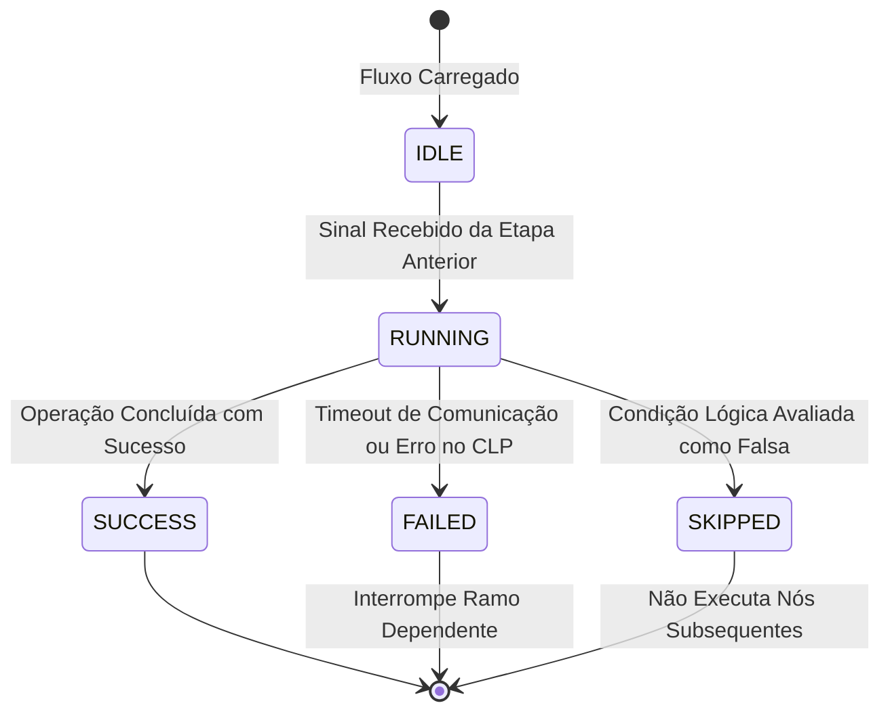

# Documentação Viva: Motor de Grafo Acíclico Dirigido (DAG Engine)

O **DAG Engine** do MachineFlow é responsável por interpretar, validar e executar receitas industriais representadas graficamente por nós (*nodes*) e arestas (*edges*).

---

## 1. Topologia e Grafo

Um fluxo válido no MachineFlow é matematicamente um **Grafo Acíclico Dirigido (DAG)**:
- **Acíclico:** Não podem existir laços infinitos ou retroalimentações diretas sem temporização explícita.
- **Dirigido:** Cada aresta possui origem (*source*) e destino (*target*), estabelecendo a ordem causal da automação.

### Algoritmo de Validação de Ciclos
O motor utiliza Busca em Profundidade (DFS) com pilha de recursão para detecção estrita de ciclos:
```typescript
// Se um nó em visitação for encontrado na pilha de recursão ativa:
// => Ciclo detectado, deploy rejeitado com HTTP 400.
```

---

## 2. Máquina de Estados dos Nós

Cada nó percorre o seguinte ciclo de vida durante a execução de uma receita:



---

## 3. Intertravamento de Segurança com SafetyGuard

Antes de qualquer ação física disparada por um nó do tipo `machineAction`:
1. Verifica se a Parada de Emergência está acionada (`SafetyGuard.isSafeToExecute()`).
2. Aplica controle de cadência de comandos (`SafetyGuard.assertRateLimit()`) garantindo intervalo mínimo de 50 ms entre escritas no mesmo endereço IP.
3. Executa leitura de confirmação pós-escrita (*read-after-write verification*).

